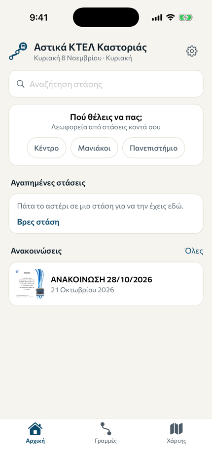
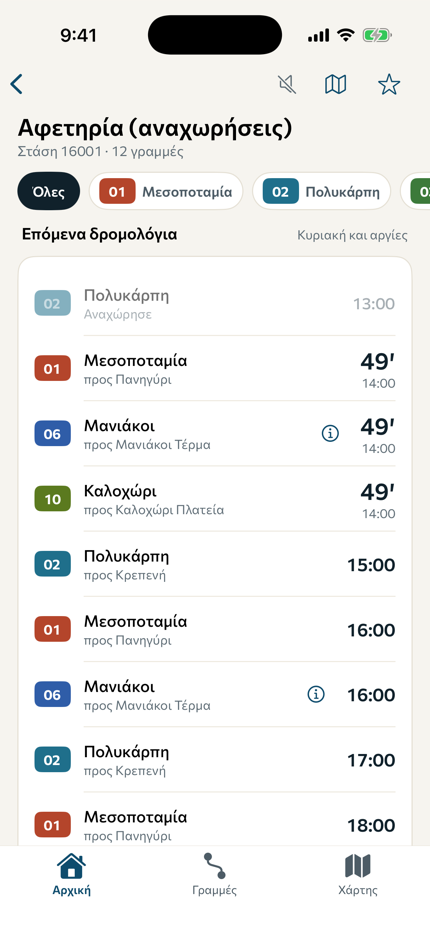
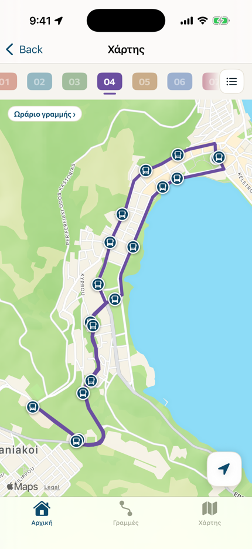
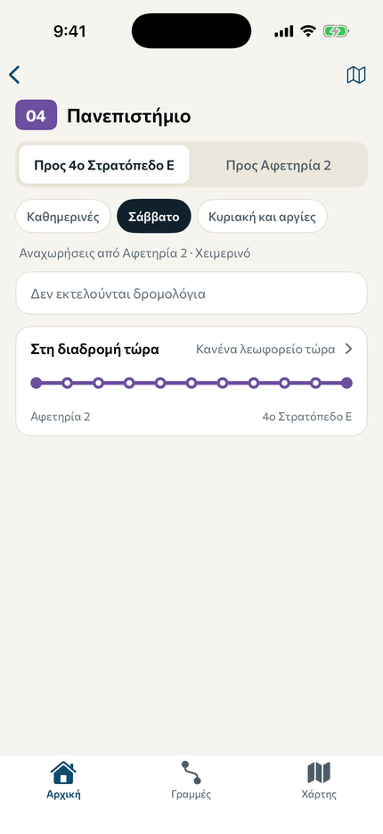
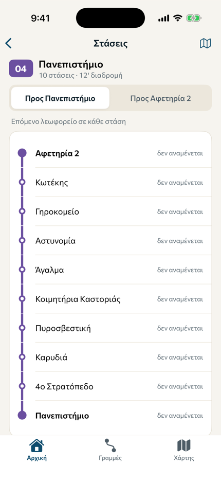
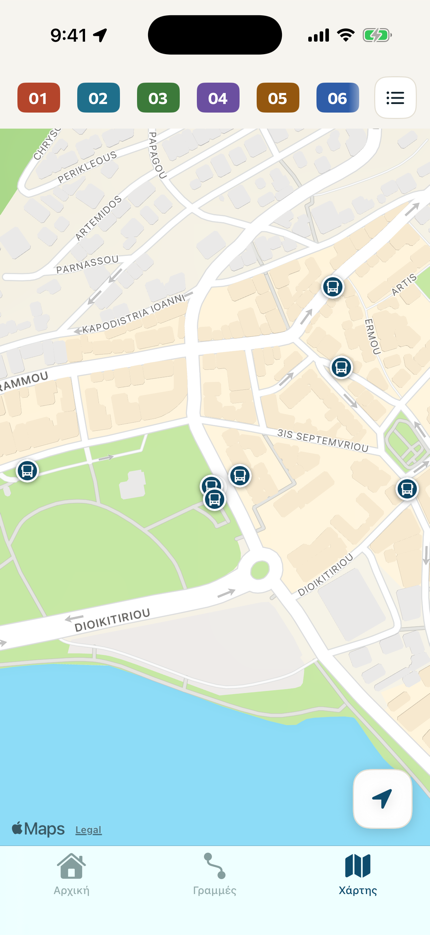
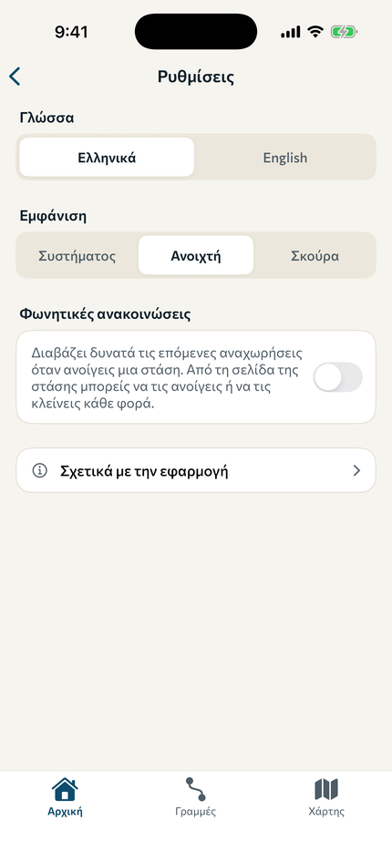
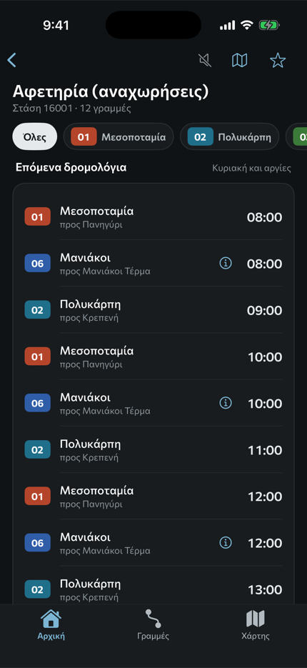

<div align="center">
  
  <h1>Kastoria City Buses for iOS</h1>
  <p>Every city bus line, stop and timetable in Kastoria, on your iPhone.</p>
</div>

The iPhone version of [astiko-ktel-kastorias-app](https://github.com/Kastoria-Dev-Core/astiko-ktel-kastorias-app). It's written in SwiftUI and does the same things the same way:

* The same data: the network the Android repo publishes (`transit.json`), downloaded at start so a timetable change reaches the app without a new release, with a copy built in for offline use
* The same live buses, from the drivers' phones through [astiko-ktel-live](https://github.com/Kastoria-Dev-Core/astiko-ktel-live)
* The same announcements, from astiko-ktel-announcements
* The same text in Greek and English, brought over from the Android `strings.xml`
* The same rules: the timetable logic, holidays and Orthodox Easter, the journey planner, the bus estimates and the live times are ports of the Kotlin code, with the same tests

## Screenshots

From the iPhone simulator on CI (`scripts/screenshots.sh`):

<p>




</p>
<p>




</p>

## Features

* Next departures for any stop, with live times (the signal icon) for buses whose phone is sending
* Favourite stops on Home, search in Greek, English or Greeklish, with or without accents
* "Where do you want to go?": the buses from the stops near you to the centre, Maniakoi or the university
* Every line with its full timetable, the operator's notes, and where its buses are along the route
* A map of every stop with Apple Maps, a filter per line with its route along the streets, the buses, and a card with the next departures when you tap a stop
* Voice announcements of a stop's next buses
* The operator's announcements with their posters
* Greek and English, light and dark, chosen in Settings

## Installing it without an Apple developer account

Releases are unsigned `.ipa` files:

https://github.com/Kastoria-Dev-Core/astiko-ktel-kastorias-ios/releases

To put one on an iPhone from Windows, use [Sideloadly](https://sideloadly.io/) (or AltStore). It signs the app with a free Apple ID as it installs it. Apple lets such an install run for 7 days, after which you install it again. It needs iOS 17 or newer.

Every pull request also builds one, under the run's Artifacts ("ipa").

## Building it

CI builds the app on macOS runners:

1. [XcodeGen](https://github.com/yonaskolb/XcodeGen) makes `AstikaKastorias.xcodeproj` from `project.yml`. The project file isn't committed: `project.yml` is the project
2. `build.yml` runs the tests on the iPhone simulator on every pull request and push to `main`, and on pull requests builds an unsigned app for real iPhones (Artifacts, "ipa")
3. `screenshots.yml` opens the main screens on the simulator in Greek and English, light and dark, records the app starting, and keeps it all (Artifacts, "screenshots"), so a change to the screens can be looked at in the pull request. It takes a while, so it runs only on pull requests that change the screens or resources, and from the Actions tab

On a Mac:

```bash
brew install xcodegen
xcodegen
open AstikaKastorias.xcodeproj
```

## Releasing

Like the Android app: bump `MARKETING_VERSION` in `project.yml` and merge. `.github/workflows/release.yml` publishes release `v<version>` with the `.ipa`, only when the version goes up.

## When there's a developer account

The App Store and TestFlight need an Apple Developer Program membership (99 USD a year). With one:

* Set `DEVELOPMENT_TEAM` in `project.yml`
* Add the signing certificate and an App Store Connect API key as repository secrets, and have `release.yml` archive, sign and upload to TestFlight instead of making an unsigned `.ipa`. That runs on GitHub's macOS runners too
* The bundle id is `com.kastoriadevs.astikoktel`

The App Store adds terms the GPL doesn't allow on its own, so `NOTICE` has an extra permission from the authors for the App Store and TestFlight.

## How the code is laid out

```
project.yml              the Xcode project, for XcodeGen
App/
  Resources/
    transit.json         the whole network, the same file the Android repo publishes
    strings.json         Greek and English text, made by scripts/import_strings.py
    Fonts/               Commissioner, as in the Android app
    Assets.xcassets      the icon, the app mark and the colours
  Sources/
    App/                 the app entry, the shared container, the strings
    Data/                models, the network, live buses, announcements, settings, location
    Domain/              timetable logic, bus estimates, live trips, journey planner, search
    UI/                  the screens and the pieces they share
Tests/                   the timetable logic and checks against the bundled network
scripts/
  import_strings.py      brings the text over from the Android app
  screenshots.sh         the screenshots CI takes
```

To bring new text over after the Android app changes its strings:

```bash
python scripts/import_strings.py
```

## Code documentation

Every type, property and function has a doc comment, and the docs are a site like the two other repos':

https://kastoria-dev-core.github.io/astiko-ktel-kastorias-ios/

`scripts/gen_docs.py` makes it (a Doxygen-style generator for Swift, with the same look as the Android app's) and `.github/workflows/docs.yml` publishes it on every push to `main`. To make it locally, into `docs/html`:

```bash
python scripts/gen_docs.py
```

## License

[GNU General Public License v3.0](LICENSE) or later, like the Android app. See [NOTICE](NOTICE).
